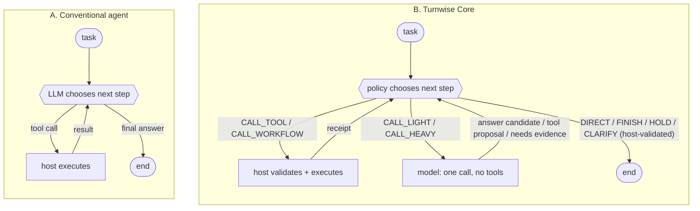

# Turnwise Decision Lab: route the work, not just the model

Most tool-using agents ask a capable LLM what to do next, after every tool result, until it decides to stop. **Turnwise asks whether a small, typed decision policy could make that choice instead**, at every step, and call tools, deterministic workflows or a capable model only when the work needs them.

This repository is a **research lab, not an agent framework**. It contains a runnable demonstration of that control pattern inside two real agent SDKs, earlier synthetic routing experiments with mixed and partly negative results, and the protocol for the experiment that could falsify the idea. **Nothing here yet shows that Turnwise is cheaper, faster or as good as a conventional agent.**

## The difference in one picture



In **A**, when the model asks for a tool, the framework runs it. In **B**, the model's tool request is only an *observation*: the policy decides whether to adopt it, and the host validates whatever the policy chooses. A capable model is one operation the policy may select, not the controller of every operation. The host, not the policy or the model, owns permissions, argument checks, side effects and whether a run may finish.

The operations: `DIRECT` answers from a host-verified record with no model or tool. `CALL_TOOL` and `CALL_WORKFLOW` ask the host to run one registered read or deterministic workflow, which returns a **receipt** (the host's record of what was executed). `CALL_LIGHT` and `CALL_HEAVY` make one call to a cheaper or a capable model. `FINISH` asks the host to accept a model's answer candidate after checking its cited receipts. `HOLD` and `CLARIFY` stop visibly, for example when a write needs human approval.

### Why consider this?

Many agent steps need no reasoning: a verified fact, a read tool, a workflow that already exists. If a generative model chooses every step, every step pays for generative control and exposes the full tool catalogue and conversation. A cheap policy might avoid some of that while keeping the capable model for the steps that need it. Whether that saves anything once the policy's own cost and failures are counted is **the open question this lab exists to answer**.

The policy is a pluggable interface (`Policy.decide(snapshot) -> Decision`). Today's implementation is hand-written rules, which makes it close to the "host rules" null below. The research question is whether a learned model, a cheap LLM or a decision service such as Jev behind that interface does better than plain rules, or whether rules are enough.

### What Turnwise is not

| Mechanism | What it decides | Relation to Turnwise |
|---|---|---|
| **Model router** (e.g. LiteLLM auto routing) | *Which* model answers, once per request | Composable. Turnwise decides *whether* and *when* a model is called, after every observation |
| **Tool search / context pruning** | Which schemas and evidence the model sees | Composable. Addresses a different cost |
| **Deterministic graph** (e.g. LangGraph edges) | Pre-written transitions | A Turnwise policy *could be* implemented with one. The question is whether a policy beats explicit host rules |
| **Host rules** | Fixed checks before or around an agent | The strongest null comparator, which Turnwise must beat |
| **Native-agent handoff** (`HANDOFF_AGENT`) | The policy hands a native agent its own loop for a bounded segment | A **different architecture**, shown only for contrast. It is not Turnwise Core |

More on prior art and fair comparisons: [comparators](docs/comparators.md), and [common objections](#common-objections) below.

## See it working (offline, about one minute)

The same incident-investigation agent, built on the **OpenAI Agents SDK** and on **LlamaIndex**, runs once conventionally and once under Turnwise Core. Same task, tools, synthetic data, host, permissions and (simulated) model.

The demo needs Python 3.11+ (required by `llama-index-core` 0.14); the rest of the lab runs on 3.10+.

```bash
pip install -r examples/architecture/requirements.txt
```

```bash
python -m examples.architecture.run_demo --brief
```

Committed output ([`sample_output/all-scenarios-brief.txt`](examples/architecture/sample_output/all-scenarios-brief.txt); CI fails if it changes):

```text
=== Side by side: who chose each operation ===
A: Conventional agent                                      | B: Turnwise Core
-----------------------------------------------------------+-----------------------------------------------------------
   1  LLM -> tool error_trend                              |    1  policy -> CALL_TOOL error_trend
   2  LLM -> tool recent_deploys                           |    2  policy -> CALL_TOOL recent_deploys
   3  LLM -> tool validate_config                          |    3  policy -> CALL_HEAVY => proposes validate_config
   4  LLM -> final answer, run ends                        |    4  policy -> CALL_WORKFLOW validate_config (adopts m1)
                                                           |    5  policy -> CALL_HEAVY => answer candidate
                                                           |    6  policy -> FINISH [finished]
  result: completed (SDK final_output)                     |   result: finished
```

At A3 the model's request for `validate_config` simply runs. At B3 the same request comes back to the policy as data, and at B4 the policy adopts it (`m1` is that first model outcome) because it is a registered read not yet done. An unrequested `rollback_deploy` proposal is declined by the policy, and refused by the host even under a policy that adopts everything; both are covered in [`tests/test_architecture_core.py`](tests/test_architecture_core.py).

**How to read this.** The SDK code paths are real (`Runner.run_sync`, `FunctionTool`, `FunctionAgent`, `structured_predict`). **The model is simulated**: a deterministic stand-in written by the same author as the policy, and this showcase step was authored to produce a proposal. The trace demonstrates *control flow*, not reasoning quality, cost or latency. Real-provider paths now have a bounded rehearsal against a **simulated HTTP provider** (PR #54), but **no paid inference or actual model behaviour has been tested**. Use `python -m examples.architecture.live_smoke` for the free rehearsal; `run_demo --live` refuses and directs you to the bounded harness.

Full walkthrough, per-step traces, parity notes and limitations: [`examples/architecture/README.md`](examples/architecture/README.md).

## What the evidence says so far

There are two kinds of evidence on `main`: the architecture demo above, which shows a control pattern (not a performance result), and the v0.5 routing experiment, which measured outcomes on synthetic data.

**v0.5 in brief.** v0.5 predates the per-step design: it tested *per-turn* routers, each deciding once per user message whether a turn needs a model, a tool or a workflow. 46 synthetic incident turns in 10 sessions were replayed through seven routing designs. Every tool and workflow really ran; no model was called, and a model path was scored correct if the needed evidence was available (an assumption that favours model calls). The "joint router" combines the path decision with session state (memory of earlier turns, for follow-ups) and route-aware context selection.

| Design | Correct* | Model calls | Silent wrong answers | Visible failures |
|---|---:|---:|---:|---:|
| Tool-calling agent on every turn (correct by assumption) | 46/46 | 78 | 0 | 0 |
| Joint router: session state + route-aware context | 38/46 | 20 | 6 | 2 |
| Joint router without session state | 43/46 | 43 | 1 | 2 |
| Oracle: cheapest correct path (upper bound) | 46/46 | 9 | 0 | 0 |

\*Upper bound for every design that calls a model. Three more designs are in the [full report](reports/arena.md).

- **There is headroom on this authored, lookup-heavy workload**: the oracle answers 37/46 turns with no model call. Real traffic may differ.
- **"Completed" is not "correct"**: all 6 silent wrong answers carried a `completed` receipt. Session state solved follow-ups and also caused most silent errors.
- **Route-aware context selection was falsified** (pre-registered H3).
- **The host held every forged write** (18/18), but the router also **dropped two action requests** before any approval step. Zero unauthorized writes is not the same as handling every action correctly.

Explore every turn under every design in the **[interactive explorer](https://dgenio.github.io/turnwise-decision-lab/)**.

<details>
<summary>v0.5 integrity measures, caveats and smaller findings</summary>

- **Integrity.** Hypotheses were committed before any code ([`d46b085`](https://github.com/dgenio/turnwise-decision-lab/commit/d46b085)); routers and sessions were frozen before the first scored run ([`49775f7`](https://github.com/dgenio/turnwise-decision-lab/commit/49775f7)). The one post-freeze change, a scoring fix, is disclosed in the report. A test proves no router can read the labels (`needs`, `family`, `mode`, `action`), and another pins the hypothesis verdicts.
- **Exchange rate.** The joint router saves about 7 model calls per extra failure; without state, about 12. If a visible failure costs as much as 3 model calls, the joint router beats the always-agent only while a silent wrong answer costs less than 8.7 model calls (29 without state). The explorer lets you set both weights.
- **Smaller measured facts.** Tool schemas make up 72% of the always-agent's input characters. The median turn goes from 2 sequential model calls to 0 under the joint router.
- **Explorer caveat.** The alternative-path captions are illustrative, derived from gold labels, not executed counterfactuals. The strategy cells are actual offline replays.
- **Weaknesses.** One author wrote everything, and the sessions have now been seen. Matching and retrieval are deliberately lexical. 46 turns show mechanisms, not rates with confidence intervals. Model-tier routing was not evaluated.

</details>

**All evidence layers at a glance** (details in [release status](docs/release-status.md)):

| Evidence | Status | What it shows |
|---|---|---|
| [Architecture demo](examples/architecture/README.md) (on `main`, PRs #51, #52) | **Demonstrated with simulated inference** | The control pattern composes with two real SDKs through public APIs, with no monkey-patching. No quality, cost or latency claim |
| [v0.5 outcome-scored routing](reports/arena.md) (on `main`) | **Experimentally measured**, authored synthetic data, **no model called** | Large no-model headroom, but state-aware routing fails silently. Details below |
| [v0.4 route-label benchmark](reports/trained-routing-synthetic.md) (on `main`) | **Historical**, superseded by v0.5 | Simple rules matched 38/40 labels; a tiny classifier 29/40. No gain over rules |
| v0.6 local-inference loop ([PR #6](https://github.com/dgenio/turnwise-decision-lab/pull/6)) | **Held / inconclusive**, not merged | Used a small 0.8B local model as its "heavy" tier (not a capable baseline); 0/7 investigations for the decision-driven arm; silent misses |
| v0.7/v0.8 safety and exit-gate work ([#37](https://github.com/dgenio/turnwise-decision-lab/pull/37), [#38](https://github.com/dgenio/turnwise-decision-lab/pull/38), [#46](https://github.com/dgenio/turnwise-decision-lab/pull/46)) | **Held**, draft, not merged | v0.7 concluded SHRINK (simpler wins) under a weak model. Not current truth on `main` |
| Real-provider readiness for the demo (PRs [#54](https://github.com/dgenio/turnwise-decision-lab/pull/54), [#58](https://github.com/dgenio/turnwise-decision-lab/pull/58)) | **Implemented and tested offline**; one paid run **inconclusive** | Provider classes exercised against a simulated HTTP endpoint. The single authorised real-model run ([run 44520205372](https://github.com/dgenio/turnwise-decision-lab/actions/runs/44520205372)) exited INCONCLUSIVE; its results are not recorded here |
| Capable heavy-only agent baseline, real model inference, cost | **Not tested** | The decisive experiment ([#9](https://github.com/dgenio/turnwise-decision-lab/issues/9)) has not been run |

## What is not yet proven

- **No quality, cost or latency benefit** against a real, capable, tool-using agent. That comparison has not been run.
- **No real-model behaviour is established for the architecture demo.** The one authorised paid smoke run ended INCONCLUSIVE and its results are not recorded in the repository. Real models may return malformed typed outputs, ignore the step contract or choose differently.
- **No learned or decision-service policy** (Jev or otherwise) has been evaluated; the demo policy is hand-written keyword rules.
- **No independent data.** One author wrote the world, cases, labels, policies and simulated model.
- **The host checks provenance, not truth.** `FINISH` verifies that cited receipts exist, not that the answer is causally right.

**What would falsify the idea:** simple host rules plus the same capable agent matching Turnwise's quality at equal or lower total cost, or the policy's overhead and silent failures erasing its savings. See [the hypothesis and falsifiers](docs/per-step-execution-hypothesis.md#scientific-null-ablations-and-kill-criteria) and the [prospective study gate (#9)](https://github.com/dgenio/turnwise-decision-lab/issues/9).

## Common objections

**Isn't this just a state machine?** The policy in the demo is little more than one. The research question is not whether a loop can be written but whether *moving next-step control out of the generative model* preserves quality at lower cost. Conditional execution is not claimed as new.

**Can't LangGraph already do this?** Yes, probably with existing primitives (conditional edges, `Command`, interrupts); a [source check](docs/framework-integration-roadmap.md) found no missing hook. Turnwise is meant to compose with frameworks, not replace them.

**How is this different from a model router?** A router picks a model once, then hands it control. Turnwise re-decides after every observation, including the model's own output.

**Why not a better prompt, or fewer tools?** Both are legitimate baselines. A checklist-prompted native agent ([#43](https://github.com/dgenio/turnwise-decision-lab/issues/43)) and native tool search are required comparators, not straw men.

**Why not simple host rules?** They may be enough. Rules plus the same capable agent are the **mandatory null arm**; if they win, the right outcome is SHRINK (keep only the parts that earn their place) or STOP.

**Does a decision call at every step actually save anything?** Unknown. Every policy call, retry and fallback must be counted. A negative answer, rigorously obtained, is a useful result.

## Explore the project

| If you want to... | Start here |
|---|---|
| Understand the hypothesis, contract and falsifiers | [docs/per-step-execution-hypothesis.md](docs/per-step-execution-hypothesis.md) |
| See it in code | [examples/architecture/](examples/architecture/README.md) (`turnwise_core.py`, `policies.py`) |
| Read the measured v0.5 results | [reports/arena.md](reports/arena.md) and the [explorer](https://dgenio.github.io/turnwise-decision-lab/) |
| Know what is current, held or historical | [docs/release-status.md](docs/release-status.md) |
| Browse every document by purpose | [docs/README.md](docs/README.md) |
| Contribute, or point a coding agent at the repo | [CONTRIBUTING.md](CONTRIBUTING.md) and [AGENTS.md](AGENTS.md) |

### Reproduce the v0.5 lab (Python 3.10+, no dependencies, no network, no keys)

```bash
python -m unittest discover -s tests
```

```bash
python -m turnwise_lab.arena
```

```bash
python -m turnwise_lab.explorer
```

The arena rewrites `reports/arena.json` and `reports/arena.md`; the explorer rebuilds `demo/index.html`. CI regenerates every committed report and page and fails on a single byte of difference. Without the SDKs installed, the framework-specific architecture tests are skipped.

## Contributing

The most valuable contributions are **evidence, not features**: independently authored held-out cases, alternative policies, strong native-agent baselines, safety and evidence failures, quality-constrained experiments, and framework-specific investigations. See [CONTRIBUTING.md](CONTRIBUTING.md). Not every proposal belongs in the core runtime, and a well-supported negative result is welcome.

## Related work by the same author

[ContextWeaver](https://github.com/dgenio/contextweaver) (capability snapshots), [ChainWeaver](https://github.com/dgenio/ChainWeaver) (deterministic flow promotion), [agent-routing-eval-lab](https://github.com/dgenio/agent-routing-eval-lab) (off-policy evaluation of logged decisions) and [agent-kernel](https://github.com/dgenio/agent-kernel) (runtime authorization). This repository does not modify them; its host harness (`LocalHarness`) is an educational stand-in, not a security boundary.

**Name.** "Turnwise" is also used by an unrelated [arXiv paper](https://arxiv.org/abs/2603.16759) and PyPI packages for conversation evaluation ([details](docs/comparators.md#nameprior-art-collision-important-before-promotion)). This repository is not affiliated with them and is not published to PyPI.

MIT licensed. All data is synthetic and invented for these experiments.
