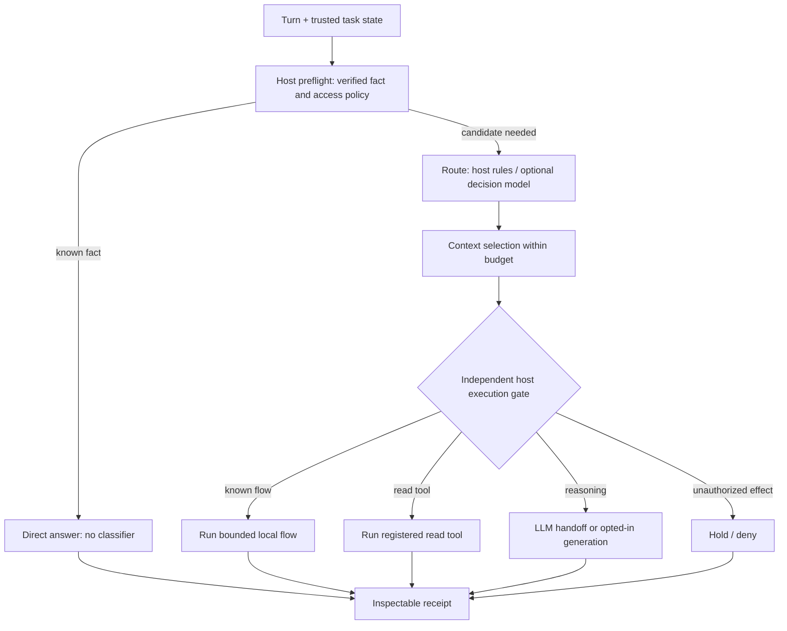

# Turnwise — route the work, not just the model

**One turn. Four possible paths. One decision worth measuring.**

> Should this agent turn be answered from a verified fact, handled by a known deterministic flow, delegated to a read tool, or sent to a reasoning model — and exactly which evidence should that model see?

Turnwise is a **runnable engineering exhibit and falsifiable research experiment**. It is not a new agent framework, production router, security boundary or benchmark leaderboard. It complements, and may ultimately be made redundant by, strong native model/tool routing.

**[Open the live interactive exhibit](https://dgenio.github.io/turnwise-decision-lab/)** · **[Inspect functional local execution receipts](https://dgenio.github.io/turnwise-decision-lab/local-run.html)** · **[Read the initial trained benchmark](reports/trained-routing-synthetic.md)**

## Two-minute reproduction (Python 3.10+, zero dependencies)

```bash
python -m unittest discover -s tests -v
python -m turnwise_lab.live_demo --output reports/live-local-run.json
python -m turnwise_lab.benchmark --output reports/trained-routing-synthetic.json --markdown reports/trained-routing-synthetic.md
```

The functional demo **really invokes local Python read handlers and a deterministic validation flow**, and emits a JSON receipt for each turn. For generation-requiring turns it produces a **handoff**, not a fabricated answer. All data are public-style, explicitly synthetic and locally authored. No AI service is called by these commands.

| Turn | Route | Observed local result |
| --- | --- | --- |
| Confirm reference | no generation | Host-verified reference returned |
| Validate baseline | known flow | Python handler ran, detected changed timeout |
| Check health | read tool | Python handler returned synthetic 6.4% error rate |
| Explain incident | reasoning handoff | Relevant source IDs selected; **no answer generated** |
| Publish report | approval hold | Action denied; no write performed |
| Follow-up question | reasoning handoff | Prior summary + relevant evidence selected |

`demo/local-run.html` renders the actual JSON receipts; `demo/index.html` remains the earlier **planning-only** six-turn exhibit with fixture-fed decisions. Keeping these two exhibits separate prevents a visual demo from being mistaken for measured inference.

## Initial result: the simple baseline wins the argument so far

A **real (albeit tiny) trained Naive Bayes text classifier** was fitted to **60 authored synthetic route-labeled training prompts**. It was then evaluated on **40 disjoint authored synthetic test prompts**. The simple rules were frozen prior to running this test.

| Arm | Authored-label matches | Missed `hold` (of 8) | Classifier calls |
| --- | ---: | ---: | ---: |
| Host rules + verified-answer fast path | **38/40 (95%)** | **0** | **0** |
| Tiny fitted Naive Bayes (without host preflight; ablation) | 29/40 (72.5%) | 5 | 40 |
| Host preflight + Naive Bayes (fallback to rules) | **38/40 (95%)** | **0** | **23** |

**These are route-label matches, not real task success or savings.** The classifier is genuinely fitted rather than fed fixture decisions; it is not Jev or an LLM, its scores are not calibrated, and all examples were written by the same project author. The experiment does not yet demonstrate an advantage for the additional classification layer. We include its mistakes in full rather than selecting attractive cases. The hybrid ran its classifier **23 times**, but accepted only **2** predictions; the other decisions used host preflight or fell back to rules.

Reproduce and inspect all mistakes: [`reports/trained-routing-synthetic.md`](reports/trained-routing-synthetic.md), raw per-case outcomes [`reports/trained-routing-synthetic.json`](reports/trained-routing-synthetic.json), input splits [`fixtures/route_train.jsonl`](fixtures/route_train.jsonl) and [`fixtures/route_test.jsonl`](fixtures/route_test.jsonl).

**What is measured:** actual Python route inference on frozen test prompts, actual local handler invocation, authorization holds, locally generated context IDs, and real local policy execution timing (not provider latency). **What is not measured:** frontier-model calls saved, generative-answer quality, live model-router comparisons, native tool search, security certification, real API economics, throughput, or independent adopter value. `cost_usd`, token usage and end-to-end task success are **null** in the report, not zero.

## Architecture and trust boundaries



The classifier **proposes** a path; it never grants permission. The `LocalHarness` independently checks a registered capability, identity permissions, side-effect metadata and explicit host approvals. Its default **denies all writes**, even with a forged plan and apparent approval. It is educational local code, **not** complete mediation or a hardened policy engine. Similarly, the SHA-256 receipt digest is a deterministic fingerprint, **not** a cryptographic audit attestation.

The older [`Planner`](turnwise_lab/core.py) supports a typed route + model tier + context mode and can use a real Jev adapter after explicit public-data opt-in; **the Jev adapter has not been executed against a live provider**. The new [`TinyMultinomialNB`](turnwise_lab/learning.py) is a route-only baseline, not joint learned planning. Context packing is deterministic lexical selection; model-tier evaluation is not claimed. The joint-route/context thesis remains a hypothesis.

## Optional single real-generation smoke call (not part of the benchmark)

Only with a chosen OpenAI-compatible provider and explicitly **public synthetic** input:

```bash
export OPENAI_API_KEY='your-own-key'
python -m turnwise_lab.provider_cli \
  --endpoint 'https://your-provider.example/v1/chat/completions' \
  --model 'your-supported-model-id' --allow-remote
```

The adapter is tested against an in-process **fake HTTP server** only; it has **not** been tested on a real hosted generation model. Network egress is disabled unless `--allow-remote` is supplied. The local PII/secret check is deliberately incomplete; *do not send employer, customer or confidential data to it*. The adapter reports provider usage if returned and **never invents USD costs**. See [provider boundaries](docs/model-backend.md).

## Why this question matters

A cheaper model is not automatically a cheaper agent. A classifier adds latency and its errors can cause a failed execution, a costly retry, omitted context, or a permission problem. The correct evaluation unit is **cost per correctly resolved task**, with strict safety gates and measured end-to-end latency — not classification confidence or token reduction against a deliberately weak baseline.

This is **not a novelty claim**. Contemporary [LiteLLM Auto Router](https://docs.litellm.ai/docs/auto_router/) supports decision classifiers and shadow evaluation. [vLLM Semantic Router](https://vllm-sr.ai/docs/overview/signal-driven-decisions/) supports decision signals and policy-driven model selection, including model/tool/context-adjacent functionality. [OpenAI's native tools and tool search](https://developers.openai.com/api/docs/guides/tools) are serious baselines. The research asks what — *if anything* — a separate per-turn planner adds beyond these mechanisms, when compared fairly.

The next proper experiment requires independently labeled held-out multi-turn tasks, at least one **real current** native/model-router arm, recorded provider/model versions, task-level checkers, complete cost including retries, p50/p95 latency, context recall, tool/argument correctness and explicit non-exposure/authorization gates. See [evaluation protocol](docs/evaluation-plan.md) and [competitor matrix](docs/comparators.md).

## Reproducibility & tests

```bash
python -m unittest discover -s tests -v
python -m turnwise_lab                    # original planning-only CLI
python -m turnwise_lab.evaluate          # eight trivial contract smoke cases
python -m turnwise_lab.live_demo
python -m turnwise_lab.benchmark
python -m scripts.render_local_demo      # regenerate static functional exhibit
```

All main commands are offline by default. Source and output are MIT-licensed. The initial test set is **not** protected by an independent labeler; SHA-256 input hashes in the report identify the exact files evaluated. Timing microbenchmarks vary by machine and should not be interpreted as production latency. Full reported failure cases are retained.

## Relation to the Weaver work

- [ContextWeaver](https://github.com/dgenio/contextweaver) is currently testing D1 capability snapshots and semantic drift. Its [controlling decision](https://github.com/dgenio/contextweaver/issues/758) explicitly parks D2/D3 routing experiments behind adoption evidence. **This repo does not modify it or restart its roadmap.**
- [ChainWeaver](https://github.com/dgenio/ChainWeaver) explores evidence-backed deterministic flow promotion; Turnwise does not reproduce that governance process.
- [agent-routing-eval-lab](https://github.com/dgenio/agent-routing-eval-lab) is dedicated to off-policy evaluation on logged decisions; Turnwise is an independent demo, not a replacement.
- [agent-kernel](https://github.com/dgenio/agent-kernel) addresses runtime authorization enforcement, a separate security boundary.

**Current research decision: HOLD on product claims and enterprise integration, GO on a narrow, honestly instrumented public engineering exhibit.** Negative evidence is an intended outcome.

See [release status](docs/release-status.md), [privacy/threat model](docs/privacy-threat-model.md), [research question](docs/why-this-exists.md) and [publishing instructions](docs/publish.md).
