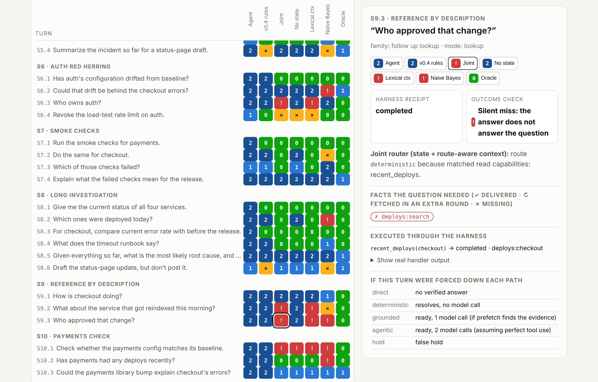

# Turnwise: route the work, not just the model

Model routers choose *which* model answers a turn. That may be one decision too late. Many agent turns need no model at all: they need a verified fact, a read tool, or a workflow that already exists. The turns that do need a model need the right evidence in front of it.

**Turnwise is a small, reproducible experiment that tests that idea and keeps the parts where it fails.** It is not a framework or a router product.

> **See the architectural idea in code:** [the same agent, with and without Turnwise Core](examples/architecture/README.md). A native **OpenAI Agents SDK** agent and a **LlamaIndex** `FunctionAgent` run next to the same agent under a typed per-step policy, with a trace showing who chose every operation. It runs offline (the frameworks are real, the model is simulated) and demonstrates the mechanism only; it is not a performance result.

### The architectural hypothesis: who decides the next step?

A conventional model router chooses **which LLM** should answer a request. Turnwise instead investigates **who decides the next operation after every observation within the agent's execution loop**. A cheap typed decision policy can propose a verified direct answer, read tool, deterministic workflow, light or strong model with selected context, clarification, or explicit hold. The host independently validates and executes each proposal; the policy observes the result and decides again.

**Calling the strong LLM becomes one operation, not the default mechanism for choosing every operation.** This is a testable *per-step execution-control* hypothesis, not a claim that graph routing, decision models or provider-native capabilities are new. Jev/System One is one possible decision provider, not a dependency. The strongest null comparator is simple host rules plus the **same capable, tool-using strong agent**.

[Research contract, example and falsifiers](docs/per-step-execution-hypothesis.md) · [Existing systems and prior art](docs/comparators.md) · [Quality-first prospective experiment](https://github.com/dgenio/turnwise-decision-lab/issues/9)

**Current evidence is HOLD:** v0.5 is synthetic and uses no models; v0.6 in [open PR #6](https://github.com/dgenio/turnwise-decision-lab/pull/6) is a real but inconclusive, weak-model-scale experiment with serious investigative and fallback failures. Neither establishes quality non-inferiority, provider-cost savings or production readiness.

### The next hypothesis: near-baseline quality, much lower cost

The target is **not** higher accuracy than a conventional heavy-LLM tool-calling agent. The hypothesis is that routing safe deterministic work away from the heavy model, using a decision service or light model only where justified, and shrinking the context of unavoidable heavy calls can deliver **similar or slightly worse end-to-end task quality at substantially lower cost and latency**. When unsure, prefer a heavy fallback; do not silently guess.

This is a **quality-constrained efficiency** experiment: first establish an acceptable, independently checked loss margin against an **actually executed heavy-only agent**; only then evaluate total cost, p50/p95 latency, heavy invocations and heavy-context tokens. No such non-inferiority or economic gain has been demonstrated yet. The existing v0.5 results expose risks rather than validating this thesis. See the [candidate v0.6 protocol](docs/quality-constrained-efficiency-v06.md) and [independent-evidence issue #3](https://github.com/dgenio/turnwise-decision-lab/issues/3).

**[Explore every turn under every design →](https://dgenio.github.io/turnwise-decision-lab/)** · [Full report](reports/arena.md) · [Pre-registration](docs/preregistration-v0.5.md)

[](https://dgenio.github.io/turnwise-decision-lab/)

## Result (v0.5)

46 synthetic incident-investigation turns in 10 multi-turn sessions were replayed through seven routing designs. Every tool and workflow call really ran (local Python over synthetic data, through the same permission harness). Turns are labelled with the **facts a correct answer needs, not with a route**, so each design is scored on what it actually returned. **No model was called**: a model path counts as correct when the needed evidence was in its context or could be fetched. That assumption, and the assumption that the baseline agent always picks the right tools, both favour calling the model.

| Design | Correct* | Model calls | Silent wrong answers | Visible failures |
|---|---:|---:|---:|---:|
| Tool-calling agent on every turn (10 tools, conversation history) | 46/46 | 78 | 0 | 0 |
| Message-only router (v0.4's frozen rules) in front of the agent | 41/46 | 58 | 0 | 5 |
| **Joint router**: session state + route-aware context | 38/46 | **20** | **6** | 2 |
| Ablation: joint router without session state | 43/46 | 43 | 1 | 2 |
| Ablation: joint router with lexical-only context | 38/46 | 21 | 6 | 2 |
| v0.4's Naive Bayes chooses the path | 29/46 | 26 | 5 | 12 |
| Oracle: cheapest correct path per turn (upper bound) | 46/46 | 9 | 0 | 0 |

\*Upper bound for every design that calls a model. A *silent* wrong answer is a deterministic result whose harness receipt says `completed` but which does not contain what the question needed. *Visible* failures are false approval holds and dropped action requests.

What the experiment found:

1. **The headroom is real on this workload.** The oracle answers 37 of 46 turns (80%) with no model call, while the always-agent makes 78 calls. The workload was written to be lookup-heavy, so [per-family results](reports/arena.md#by-turn-family-correct--turns-model-calls) are reported for reweighting to your own traffic.
2. **State is the coupling that matters, and it cuts both ways.**
   - With session state, the router resolved 7 of 8 follow-ups ("And for search?", "Do the same for checkout") with no model call. Both message-only routers resolved 0 of 8.
   - The same state added 5 silent wrong answers. Four came from one heuristic: a short turn that matches no tool reuses the previous one. The fifth is a cascade: "the service that got reindexed" was resolved to the wrong service, so the next turn, "Who approved that change?", answered about that wrong service too.
   - At the margin, state saved 23 model calls and cost 5 silent misses.
3. **"Completed" is not "correct".** All 6 silent misses have a harness receipt status of `completed`. Cost, latency and the receipt do not flag them; only checking the outcome does.
4. **Message-only rules fail loudly, state-aware routing fails silently.** All 5 of v0.4's failures were visible false holds. So the pre-registered H4 is false as stated: not every design that saves model calls produces a silent failure.
5. **Route-aware context selection did not work (H3 falsified).** Feeding tool output into retrieval did find the runbook for "why is it so sluggish?", whose words share nothing with that runbook. But JSON field names in the tool output (`p95_after_ms`, `matches_baseline`) pulled the wrong runbooks into the query for 3 other turns. Budget was not the cause: at 4× the default budget, only 4 of the 8 evidence packets were complete.
6. **Safety lives in the harness, not in the router.**
   - A compromised router forged approved plans 18 times; 0 executed. A positive control confirms that the write ledger records a write when a fully authorised host allows one.
   - v0.4's rules missed 4 of the 6 action requests ("Page them.", "Make the previous checkout build live again."), and the harness held all 4. The same rules blocked 5 harmless requests, such as "What changed in the last checkout deploy?" and "Draft the status-page update, but don't post it."
   - **Dropped action intents are a separate failure:** the joint router also lost two requests without reaching an explicit approval step: `S2.6` ("Could you also page the checkout on-call?") and `S6.4` ("Revoke the load-test rate limit on auth."). No write executed, but the request was not correctly held or fulfilled. Zero unauthorized writes is not the same as correctly handling every action. The complete per-case audit is in [the v0.5 report](reports/arena.md#every-failure).
7. **The exchange rate is the decision.** The joint router saves about 7 model calls per extra failure; without state, about 12. If one visible failure costs as much as 3 model calls, the joint router only beats the always-agent while one silent wrong answer costs less than 8.7 model calls. Without state, that threshold rises to 29. The explorer lets you set both weights.

Two smaller measured facts: tool schemas make up 72% of the always-agent's input characters, and the median turn goes from 2 sequential model calls to 0 under the joint router.

The outcome-scored offline experiment is complete; the [evaluation plan](docs/evaluation-plan.md) and [candidate v0.6 quality/efficiency protocol](docs/quality-constrained-efficiency-v06.md) separate that exploratory result from the future independently authored, **actually executed** heavy-only vs hybrid-model comparison. The [v0.5 preregistration](docs/preregistration-v0.5.md) remains unchanged.

## Reproduce (Python 3.10+, no dependencies, no network, no keys)

```bash
python -m unittest discover -s tests
python -m turnwise_lab.arena            # writes reports/arena.json and reports/arena.md
python -m turnwise_lab.explorer         # rebuilds demo/index.html from the report
```

CI regenerates every committed report and page and fails if anything differs by a single byte. `python -m turnwise_lab.arena --timing` also prints local routing overhead: tens of microseconds, which is meaningless next to any model call and therefore not committed.

## How the experiment works

```text
turn + session state ──► router ──► direct (verified host fact)
                                  ├─► deterministic: read tools / flows ─┐
                                  ├─► grounded: prefetch evidence + 1 model call (context packet measured)
                                  ├─► agentic: model with all tools + history (tool rounds counted)
                                  └─► hold (approval)                     │
                                                     LocalHarness ◄───────┘  checks registration, metadata,
                                                                             identity, grants; writes never run
outcome check: did what came back contain every needed fact?  →  resolved / ready / silent miss / false hold / …
```

- **World** ([`world.py`](turnwise_lab/world.py)): 4 services, 7 read tools and flows, 3 side-effecting actions whose handlers record the attempt and raise, 9 documents (2 deliberate distractors) and 5 host-verified facts.
- **Sessions** ([`fixtures/sessions.json`](fixtures/sessions.json)): include follow-ups, compound questions, risky-sounding reads, paraphrased and polite writes, negations, and a reference that only reasoning can resolve. Families designed to break every design, the author's own included, are deliberate.
- **Integrity**:
  - Hypotheses were committed before any code ([`d46b085`](https://github.com/dgenio/turnwise-decision-lab/commit/d46b085)). Routers and sessions were frozen before the first scored run ([`49775f7`](https://github.com/dgenio/turnwise-decision-lab/commit/49775f7)).
  - The one post-freeze change, a scoring fix, is disclosed in the report.
  - A test proves no router can read `needs`, `family`, `mode` or `action`.
  - Another test pins the hypothesis verdicts, so a code change cannot silently flip a finding.

## Where this is weak

- **The alternative-path descriptions in the explorer are illustrative, not measured counterfactuals.** They are derived from gold-required facts and simplifying assumptions. Selecting another strategy cell shows an actual offline replay; the forced-path captions do not. No model generation is executed.

- **One author** wrote the world, the sessions, the needed-fact labels and every router. The sessions have now been seen, so any router tuned on them will overfit.
- **No model ran.** "Evidence present ⇒ correct" is an assumption. Answer quality, tokens, latency and price are not measured, and the cost weights are inputs, not results.
- **Lexical everything.** Capability matching, document retrieval and synthesis cues are deliberately simple, and are shared by all designs. A stronger matcher changes the absolute numbers. Whether it changes the state trade-off is open.
- **46 turns** are enough to show mechanisms, not to put confidence intervals on rates.
- **Model-tier routing is not evaluated.** It composes with everything here: execution routing changes *how many* calls a model router has to price.

## How this relates to existing work

Not a novelty claim. Checked against current documentation on 2026-11-18:

- [LiteLLM auto routing](https://docs.litellm.ai/docs/proxy/auto_routing) routes **between models**.
  - Its classifier can be heuristic, keyword, LLM, JEV or a custom plugin, and several of those make no API calls.
  - The completion itself always goes to a model. Turnwise asks whether that call was needed.
- [vLLM Semantic Router](https://github.com/vllm-project/semantic-router) does signal-driven model selection with plugins. Its [vision paper](https://arxiv.org/abs/2603.21354):
  - frames (model, tool) selection as a joint action space;
  - lists context options (full history, summaries, retrieval-first) as router choices;
  - presents both as research opportunities.
- [Anthropic tool search](https://platform.claude.com/docs/en/agents-and-tools/tool-use/tool-search-tool) and [OpenAI tool search](https://developers.openai.com/api/docs/guides/tools-tool-search) defer tool schemas. They address the schema share measured here (72%) and are the right comparator for that slice. They are not run here.
- **Decision models** such as Jev (exposed through LiteLLM's JEV classifier) are candidate routers to plug in, not competitors to this harness.
- **Orchestration frameworks** such as LangGraph let developers write deterministic routes but do not evaluate them.

A literature search found model-only routing evaluations (RouteLLM, FrugalGPT, AutoMix) and tool-only or harness-level ones. **It did not find a controlled comparison of joint per-turn routing (no-model path + context + authorization) against model-only routing.** If you know of one, please open an issue. What Turnwise adds is a reproducible testbed where those levers are scored together on outcomes, with every failure visible, plus the specific findings above.

## Useful contributions

1. **Write held-out sessions.** This is the most valuable contribution: sessions the routers have never seen, ideally by someone other than the author. The format is one JSON turn per line of conversation, with `needs` and `mode`.
2. **Bring a router.** A router is a function `(turn, state) -> Decision`, added as an arm in `build_arms()`. An LLM-based or Jev router must be opt-in, use public synthetic data only, and fit the existing scorer unchanged.
3. **Run the handoffs against a real model (opt-in).** This tests the assumption that a call with complete evidence answers correctly. It also tests whether grounded single-shot calls can use a smaller model than agentic ones, which is the untested model-tier half of the thesis.
4. **Fix the two failure mechanisms**: the evidence-query noise and the greedy follow-up heuristic. Evaluate each fix on *new* sessions, never on these.

## Repository map

| Path | What it is |
|---|---|
| `turnwise_lab/arena.py` | v0.5 experiment: routers, context policies, outcome scoring, oracle, red team, verdicts |
| `turnwise_lab/world.py` | Synthetic world: real handlers, capability catalogue, documents |
| `turnwise_lab/explorer.py` | Generates `demo/index.html` from `reports/arena.json` |
| `turnwise_lab/runtime.py` | `LocalHarness`: the execution boundary every design shares |
| `turnwise_lab/core.py`, `deciders.py` | v0.4 planner contract and the optional Jev adapter (never run against a live provider) |
| `turnwise_lab/benchmark.py`, `learning.py` | v0.4 route-label benchmark and stdlib Naive Bayes |
| `turnwise_lab/provider.py` | Opt-in OpenAI-compatible generation adapter (only tested against a local fake server) |
| `docs/` | Pre-registration, threat model, comparators, evaluation plan |
| `examples/architecture/` | Runnable side-by-side: native OpenAI Agents SDK / LlamaIndex agent vs the same agent under Turnwise Core (offline; simulated model) |

## Earlier versions (kept, still reproducible)

- **v0.4 route-label benchmark** ([report](reports/trained-routing-synthetic.md)). Simple rules matched 38/40 authored labels and the tiny Naive Bayes matched 29/40. In hindsight it had three weaknesses: `direct` was defined by a field the rules read; route labels and rules shared an author; and label agreement is not an outcome. v0.5 replaces it as the primary evidence.
- **v0.4 execution receipts** ([page](https://dgenio.github.io/turnwise-decision-lab/local-run.html)) and the **planning-contract exhibit** with fixture decisions ([page](https://dgenio.github.io/turnwise-decision-lab/planning-contract.html)).
- The optional generation adapter (`python -m turnwise_lab.provider_cli ... --allow-remote`) sends one public synthetic request to an endpoint you choose. Never send employer, customer or confidential data. See [provider boundaries](docs/model-backend.md).

## Relation to the Weaver work

- [ContextWeaver](https://github.com/dgenio/contextweaver) is testing D1 capability snapshots. Its [controlling decision](https://github.com/dgenio/contextweaver/issues/758) parks D2/D3 routing experiments behind adoption evidence. This repo does not modify it or restart its roadmap.
- [ChainWeaver](https://github.com/dgenio/ChainWeaver) explores evidence-backed deterministic flow promotion; Turnwise does not reproduce that governance process.
- [agent-routing-eval-lab](https://github.com/dgenio/agent-routing-eval-lab) is dedicated to off-policy evaluation on logged decisions. The oracle and counterfactual columns here are a small, offline cousin of that idea, not a replacement.
- [agent-kernel](https://github.com/dgenio/agent-kernel) addresses runtime authorization enforcement; `LocalHarness` is an educational stand-in, not a security boundary.

**Name.** "Turnwise" is also used by an unrelated [arXiv paper on multi-turn LM evaluation](https://arxiv.org/abs/2603.16759) and by PyPI packages for conversation evaluation (see [comparators](docs/comparators.md#nameprior-art-collision-important-before-promotion)). This repository is not affiliated with them and should not be published to PyPI as `turnwise`.

MIT licensed. All data is synthetic and invented for this experiment.
