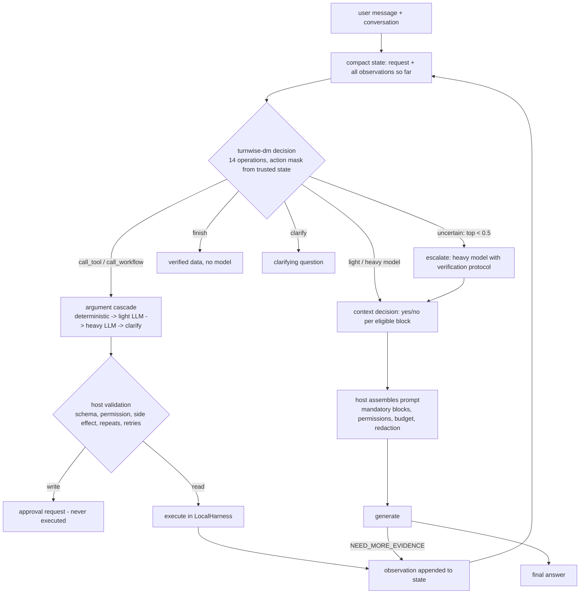

# v0.6 architecture: a decision-driven agent loop

## The proposition

> A lightweight decision model can repeatedly choose an agent's next operation, including tools, workflows and generation models, while a context-selection step builds only the prompt that operation needs. Every operation runs under an independent host policy, and every result can trigger a new decision.

v0.6 implements that proposition and compares it, on independently written tasks, with a conventional agent whose whole loop is the heavy LLM.

## Why v0.5 did not demonstrate it

| Intended | v0.5 | v0.6 |
|---|---|---|
| A **learned** decision model chooses the next operation | Hand-written rules, plus a toy Naive Bayes trained on 60 prompts | `turnwise-dm`: a trained head over real inference (one cached Qwen3.5-0.8B scoring pass + s1-llm-auto-router + typed state) |
| Decide **again after every observation** | One routing decision per user message | A bounded loop; each decision sees every earlier observation |
| Tool **results influence** the next step | Tool facts only satisfied a checklist | Different tool output leads to a different next decision (tested, and shown in the traces) |
| Choose a **generation model** | Model calls were never executed | Light (Qwen2.5-0.5B) and heavy (Qwen3.5-0.8B) tiers both actually generate |
| **Prompt blocks** per operation | Lexical document packing | A registry of typed blocks; a decision model proposes, the host assembles, and the exact prompt is recorded |
| Compare with an **LLM-driven agent** | The baseline was an *assumed-perfect* agent | A real heavy-only agent with native tool calling, scored on outcomes |

## One user turn

Guards: at most 8 steps; identical successful calls are rejected as repeats; one retry per failed call; more than two rejected proposals ends the turn safely; one verification round trip per turn.

## Components (`turnwise_lab/agent/`)

| File | Responsibility |
|---|---|
| `contracts.py` | `Decision`, `Question` (options, scores, **score kind**, latency, tokens), `ContextDecision`, `Observation` |
| `host.py` | Capability catalogue (7 reads/workflows, 3 writes) and the only execution path, through `LocalHarness`. `validate()` checks operation type, target, argument schema and enums, permission, side effects, repeats and the retry budget. |
| `loop.py` | `execute_user_turn()`, with the semantics above and a per-step trace: `user_turn_id`, `step_index`, `decision_call_id`, snapshot, decision, validation, observation, context, generation, and why the loop continued or stopped |
| `context.py` | Prompt-block registry (id, purpose, source, trust, permission, dependencies, eligibility, priority, mandatory) and the host assembler |
| `providers.py` | `HeuristicDecider` (rules baseline), `GenerativeChooser` (constrained scoring), `LearnedDecider` (turnwise-dm), `LocalLMDecider` (small LLM alone), `ArgumentBuilder`, context selectors, generators, `ScriptedDecider` (tests only) |
| `heavy_agent.py` | The primary baseline: the heavy LLM controls the loop through its own native tool-calling format, with the same host |
| `remote.py` | Opt-in OpenAI Decisions and System One (TypeSafe/Jev) adapters with a spending cap; not called in this repository |
| `dm_train.py`, `dm_features.py` | Training data generator and trainer for turnwise-dm |
| `bench.py` | Paired benchmark, outcome scoring, report |
| `demo.py` | The static trace viewer (`demo/index.html`) |

## Separating three kinds of context

1. **What the decision model sees:** `TurnState.compact_snapshot()`. The request, up to two earlier user messages, and bounded one-line summaries of observations. Never raw prompts or full history.
2. **Eligible blocks:** these depend on the current step. Tool-result blocks exist only after a tool has run; restricted blocks need a permission the demo identity does not hold.
3. **The assembled prompt:** built by the host and recorded verbatim in the trace (with redaction). Mandatory blocks cannot be removed by any policy, forbidden blocks cannot be added, and over-budget optional blocks are dropped lowest-priority first.

## Arguments: the cheapest reliable mechanism first

1. **No arguments needed:** none are built.
2. **Deterministic:** exactly one service is named in the request, or exactly one is in focus in trusted state (earlier calls or the user's earlier messages). Queries and messages use the user's text.
3. **Light model:** Qwen2.5-0.5B constrained choice over the service enum plus `unclear`, accepted only at p ≥ 0.6.
4. **Heavy model:** the same question to Qwen3.5-0.8B, accepted only at p ≥ 0.5.
5. **Otherwise clarify.** Whatever a step proposes, the host still validates the arguments against the schema.

## Conservative policy

- **Escalation gate.** If turnwise-dm's top probability is below 0.5, the step goes to the heavy model. That model runs with the verification protocol and can answer `NEED_MORE_EVIDENCE: ...`, which feeds back into the loop instead of producing a guess.
- **Action mask.** It comes from trusted state: a call that already succeeded is not offered again, and `finish` is not offered before any evidence exists.
- **Writes** become approval requests at the host whatever any model proposes.
