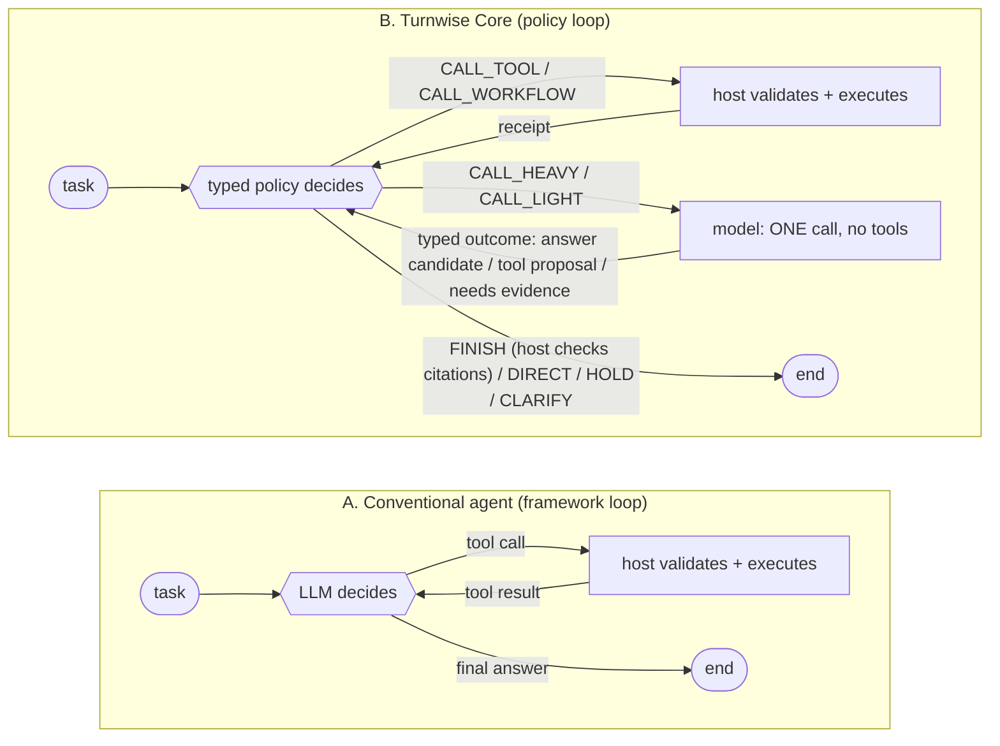

# The same agent, with and without Turnwise Core

**What this shows:** who decides the next operation. In a conventional agent the generative model decides every step. Under Turnwise Core a separate typed policy decides every step, and the model is one operation the policy may choose.

**What this does not show:** that Turnwise is cheaper, faster or better. Nothing here measures quality, cost or latency. The point is the control flow, not a result.

Both examples use **the same** task, tools, synthetic data, host, permissions, instructions and model. They come as two framework pairs:

- [OpenAI Agents SDK](openai_agents/)
- [LlamaIndex](llamaindex/)

## The one difference

| | **A. Conventional agent** | **B. Same agent, Turnwise Core** |
|---|---|---|
| Who chooses the next operation | The LLM, inside the framework's loop | A typed policy: `policy.decide(snapshot) -> Decision` |
| What a model call is | The controller of the loop | One bounded operation (`CALL_HEAVY` / `CALL_LIGHT`) chosen by the policy |
| When the model wants a tool | The framework runs it, then asks the model again | It returns a typed `tool_proposal` to the policy, which may adopt or decline it |
| Who executes tools | The shared host (validates every call) | The same shared host (validates every call) |
| How the run ends | When the model answers without a tool call | `FINISH` (host-checked), `DIRECT`, `HOLD` or `CLARIFY`, all chosen by the policy and validated by the host |



## The two code paths

**A. A plain SDK agent** ([`openai_agents/conventional.py`](openai_agents/conventional.py)):

```python
agent = Agent[HostSession](name="Incident investigator", instructions=AGENT_INSTRUCTIONS,
                           tools=[_function_tool(spec) for spec in TOOLS], model=model)
result = Runner.run_sync(agent, task, context=HostSession(host, actor="llm"), max_turns=10)
# The SDK loop: model -> tool calls -> host -> results appended -> model -> ... -> final_output
```

**B. The same agent under Turnwise Core** ([`openai_agents/turnwise.py`](openai_agents/turnwise.py), [`turnwise_core.py`](turnwise_core.py)):

```python
agent = build_agent(model)                                  # the very same agent definition
step_agent = agent.clone(tools=[], output_type=StepOutcome)  # a model step can only *propose*

for step in range(1, budget.max_steps + 1):                 # TurnwiseRuntime.run(), simplified
    decision = policy.decide(snapshot(step))                # the POLICY chooses the next operation
    ok, why = host_validates(decision)                      # ...and the host may refuse it
    if decision.op in (CALL_TOOL, CALL_WORKFLOW):
        observation = host.execute(decision.target, decision.arguments)
    elif decision.op is CALL_HEAVY:                         # one model call, typed result
        observation = Runner.run_sync(step_agent, packet, max_turns=1).final_output
    elif decision.op in (FINISH, DIRECT, HOLD, CLARIFY):
        break                                               # terminal, after host validation
    # every observation, including the model's tool proposal, goes back to the policy
```

The LlamaIndex pair has the same shape:

- **A** is a `FunctionAgent` with `FunctionTool`s.
- **B** uses one `llm.structured_predict(StepOutcome, ...)` on the agent's own LLM per model operation.

## Run it

Requires Python 3.11+ (`llama-index-core` 0.14 needs it). The core loop, host and policy are stdlib-only.

```bash
pip install -r examples/architecture/requirements.txt
```

```bash
python -m examples.architecture.run_demo
```

```bash
python -m examples.architecture.run_demo --framework llamaindex
```

```bash
python -m examples.architecture.run_demo --framework all --scenario all --handoff
```

**By default nothing leaves your machine.** The frameworks run for real: the SDK `Runner`, function-tool dispatch, structured-output parsing and LlamaIndex's agent workflow. Only the model is replaced, by each framework's own offline test double: `agents.testing.ScriptedModel` and LlamaIndex's `MockFunctionCallingLLM`. Their replies come from [`simulated_model.py`](simulated_model.py), a small deterministic investigator. It reacts only to what the framework actually passes it: instructions, the task, tool results, or the Turnwise context packet. Every trace says `SIMULATED`, and no output claims inference happened.

`--live` uses real OpenAI models. You choose the model names:

```bash
OPENAI_API_KEY=... TURNWISE_HEAVY_MODEL=... TURNWISE_LIGHT_MODEL=... python -m examples.architecture.run_demo --live
```

Live mode **costs money**. It needs `llama-index-llms-openai` for LlamaIndex, and it has **not been run or tested** by this repository or its CI.

## Real output (offline, OpenAI Agents SDK 0.25.0)

From [`sample_output/openai-agents.txt`](sample_output/openai-agents.txt). CI regenerates this file and fails if it changes:

```text
=== Side by side: who chose each operation ===
A: Conventional agent                                      | B: Turnwise Core
-----------------------------------------------------------+-----------------------------------------------------------
   1  LLM -> tool error_trend                              |    1  policy -> CALL_TOOL error_trend
   2  LLM -> tool recent_deploys                           |    2  policy -> CALL_TOOL recent_deploys
   3  LLM -> tool validate_config                          |    3  policy -> CALL_HEAVY => proposes validate_config
   4  LLM -> final answer, run ends                        |    4  policy -> CALL_WORKFLOW validate_config (adopts m1)
                                                           |    5  policy -> CALL_HEAVY => answer candidate
                                                           |    6  policy -> FINISH [finished]
  result: completed (SDK final_output)                     |   result: finished
```

The step that matters is B3 to B4, where the model asks for a tool and the policy decides:

```text
STEP 3
  controller  : Turnwise policy
  decision    : CALL_HEAVY context=[r1, r2] may_propose=[service_health, validate_config,
                search_docs]
  why         : the question needs reasoning over the evidence; use the capable model
  host        : validated; called the heavy model once via OpenAI Agents SDK:
                Runner.run_sync(agent.clone(tools=[], output_type=StepOutcome), max_turns=1)
  observation : m1 tool_proposal validate_config(service=checkout): "I need validate_config evidence
                before I can answer." -> back to the policy
STEP 4
  controller  : Turnwise policy
  decision    : CALL_WORKFLOW validate_config(service=checkout) [adopts m1's proposal]
  why         : adopt m1's proposal: a registered read that has not been done
  host        : validated and executed -> r3
  ...
STEP 6
  controller  : Turnwise policy
  decision    : FINISH with answer candidate m2
  host        : accepted m2: its citations [r1, r2, r3] are executed host receipts it was shown, and
                it claims no unexecuted action. Causal correctness is NOT verified.
```

In A the same request (`validate_config`) was simply executed: the model decided and the SDK ran it. In B it is data. The policy adopted it here because it is a registered read that has not been done yet. Given an unrequested `rollback_deploy` proposal, the policy declines it. Even a policy that adopts everything is refused by the host. Both behaviours are covered by the tests.

## The operations, and where each appears

| Operation | Meaning | Seen in |
|---|---|---|
| `DIRECT` | Answer from a host-verified record. No model and no tool. | `--scenario severity` |
| `CALL_TOOL` / `CALL_WORKFLOW` | The host executes one registered read or deterministic workflow. | every scenario |
| `CALL_LIGHT` | One call to the cheaper model, with policy-selected context. | `--scenario status` |
| `CALL_HEAVY` | One call to the capable model with policy-selected context. It returns a typed outcome and executes nothing. | `--scenario investigate` |
| `FINISH` | Ask the host to accept a model's answer candidate. The host checks that the cited receipts were executed and shown to the model, and that the answer claims no unexecuted action. It does **not** check causal truth. | `investigate`, `status` |
| `HOLD` / `CLARIFY` | Stop visibly. A held write is **not** an executed action. | `--scenario rollback` |
| `HANDOFF_AGENT` | **Contrast only, not Turnwise Core.** The native agent runs its own loop for a bounded segment. The trace labels those steps `native agent (handoff)`, and control returns to the policy afterwards. | `--handoff` |

## What the host enforces, for both architectures

[`incident_env.py`](incident_env.py) wraps the repository's existing `LocalHarness` and the synthetic world in [`turnwise_lab/world.py`](../../turnwise_lab/world.py). Every tool request goes through `IncidentHost.execute`, whether the LLM (A), the policy (B) or a handed-off agent proposed it. The host enforces:

- Only registered capabilities run, with exactly their declared arguments (for example, the service must be a known one).
- **A write needs the user's own explicit request**, parsed from the user's text only. Model text, tool output and assistant prose never create authority.
- Even a requested write is **held for human approval** and never executed. The world's write handlers record any attempt and raise, and `writes executed: 0` is printed for every run.
- In B, the host also validates each *decision*:
  - the operation kind must match the capability kind;
  - context may contain executed receipts only;
  - `DIRECT` needs an existing record;
  - `FINISH` needs a real answer candidate with valid citations;
  - claimed adoptions must match the model's proposal.
- In B, steps, model calls, tool calls and rejected decisions are all budgeted.

## What is real and what is simulated

| Component | Status |
|---|---|
| OpenAI Agents SDK `Agent`, `Runner.run_sync`, `FunctionTool`, `Agent.clone`, `output_type`, `max_turns` | **Real**, public APIs, pinned `openai-agents==0.25.0` |
| LlamaIndex `FunctionAgent`, `FunctionTool`, `structured_predict` | **Real**, public APIs, pinned `llama-index-core==0.14.26` |
| Host validation and tool execution | **Real** Python: the existing `LocalHarness` and `world.py` handlers |
| Synthetic incident data | Synthetic, from the existing v0.5 world |
| Policy | **Real code**, deterministic rules ([`policies.py`](policies.py)); not learned, tuned or evaluated |
| Model replies | **SIMULATED** offline; real only with `--live`, which is untested |

## Framework integration notes and limits

**OpenAI Agents SDK.**
- No monkey-patching and no private APIs.
- The native loop is used as-is for A and for the handoff contrast.
- Turnwise does not try to keep the SDK loop running and intercept it. It calls `Runner.run_sync(..., max_turns=1)` once per model operation, on a tool-less clone with a typed `output_type`. That is the simplest supported way to guarantee the model can only propose.
- A seam we did not use: function tools with `needs_approval=True` pause the run before a model tool call executes, so a policy could inspect it there. That keeps the SDK's loop as the owner between pauses and adds resume semantics.
- Tracing is disabled (`RunConfig(tracing_disabled=True)`) so that offline runs send nothing to the default trace exporter. This is a difference from a default SDK setup.

**LlamaIndex.**
- One finding: the final `AgentOutput.tool_calls` of a `FunctionAgent` run is extended with *every* tool call of the run. So the per-step trace reads each decision from the LLM's own response message, using `llm.get_tool_calls_from_response`.
- Turnwise's loop is not expressed as a LlamaIndex `Workflow`. It is kept framework-neutral so that both pairs share it.

**Budgets differ by architecture:** the native agents have `max_turns` / `max_iterations` = 10, and Turnwise has the `Budget` in `turnwise_core.py`. No efficiency comparison is made.

## Limitations: what this does not establish

- **No quality, cost or latency claim.** The printed counts are operation counts for one simulated run. They are not measurements. Turnwise adds policy decisions and host checks that a native agent does not have.
- **The simulated model is not a model.** It is deterministic and was written by the same author as the policy. Offline traces prove *control flow*, not reasoning ability. Real-model behaviour, such as malformed typed outputs, ignored contracts or different tool choices, is untested.
- **The policy is hand-written** for this synthetic domain. It is a stand-in for a learned or decision-service policy (Jev/System One is not used). Simple host rules may do as well, which is the open research question in [#9](https://github.com/dgenio/turnwise-decision-lab/issues/9).
- **`FINISH` checks provenance, not truth.** Evidence being present is not proof of causation.
- The write-intent parser is deliberately conservative and lexical.
- Single-turn tasks only. There are no multi-turn referents and no approve-and-resume flow.
- **Deferred from [#49](https://github.com/dgenio/turnwise-decision-lab/issues/49):**
  - null arms: simple host rules + the native agent, and a checklist-prompted native agent ([#43](https://github.com/dgenio/turnwise-decision-lab/issues/43));
  - a follow-up/retargeting scenario;
  - prompt and schema inventory parity tooling;
  - reuse of the v0.6 runtime in [#47](https://github.com/dgenio/turnwise-decision-lab/pull/47).
- This example is self-contained on `main` and does not depend on the experimental PR chain.

## Files

| File | Role |
|---|---|
| `incident_env.py` | Shared task set, tool registry (from `world.py`), receipts and `IncidentHost` (wraps `LocalHarness`) |
| `turnwise_core.py` | Typed contracts (`Op`, `Decision`, `ModelOutcome`, `Snapshot`), host validation of decisions, and the bounded loop |
| `policies.py` | `TriagePolicy` (Turnwise Core) and `HandoffPolicy` (contrast only) |
| `simulated_model.py` | Offline stand-in for model replies, the same in both architectures |
| `step_schema.py` | `StepOutcome`, the typed result of one model step |
| `openai_agents/`, `llamaindex/` | `conventional.py` (A), `turnwise.py` (B), `models.py` (simulated or live model choice) |
| `trace.py`, `run_demo.py` | Per-step controller traces and the CLI |
| `sample_output/`, `regenerate_samples.sh` | Committed offline output, checked by CI |

Tests:

- [`tests/test_architecture_core.py`](../../tests/test_architecture_core.py): stdlib only; runs in the main CI job.
- [`tests/test_architecture_openai_agents.py`](../../tests/test_architecture_openai_agents.py) and [`tests/test_architecture_llamaindex.py`](../../tests/test_architecture_llamaindex.py): run in the `architecture-examples` CI job, where a skipped framework test counts as a failure.
